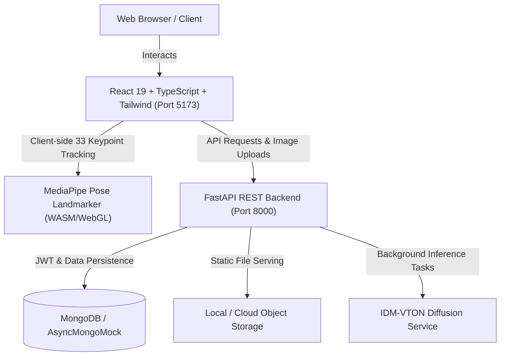

# AuraFit AI — Virtual Fashion Try-On Platform

[](https://fastapi.tiangolo.com)
[](https://react.dev)
[](https://tailwindcss.com)
[](https://developers.google.com/mediapipe)
[](https://github.com/yisol/IDM-VTON)

> A modern, commercial-ready fashion e-commerce web platform integrating deep learning neural diffusion for photo-based virtual try-on, client-side MediaPipe landmark computer vision for real-time webcam garment fitting, intelligent biometric size recommendations, and complete administrative control.

---

## 1. System Architecture



### Key Modules & Capabilities

1. **Dual Try-On Engines**:
   - **Mode 1 (Photo Virtual Try-On)**: Upload personal photograph (JPG, PNG, WEBP), select catalog garment, and trigger background neural diffusion job. Includes polling, before/after side-by-side view, download, and wardrobe saving.
   - **Mode 2 (Live Camera Try-On)**: In-browser 33-point MediaPipe pose estimation with acromioclavicular shoulder alignment, rotation angle, scaling, and snapshot capture.
2. **Product Catalog & Filters**:
   - Search by keyword, brand, category, garment type, size, and price.
   - Categorized by Upper Body, Lower Body, Full Body, and Accessories.
3. **Smart Size Recommendation**:
   - Computes recommended fit (XS–XXL) based on height, weight, chest, waist, hip, and fit cut preferences (slim, regular, relaxed).
4. **User Wardrobe & Favorites**:
   - Saved outfits gallery, favorites bookmarking, and chronological try-on audit log.
5. **Admin Operations Dashboard**:
   - Platform analytics (users, inventory, try-on throughput, success/failure metrics).
   - Real-time garment publishing with direct image upload.

---

## 2. Default Credentials & Running Ports

| Service | Address | Default Credentials |
|---------|---------|---------------------|
| **Frontend** | [http://127.0.0.1:5173](http://127.0.0.1:5173) | — |
| **Backend API** | [http://127.0.0.1:8000](http://127.0.0.1:8000) | — |
| **API Docs (Swagger)** | [http://127.0.0.1:8000/api/docs](http://127.0.0.1:8000/api/docs) | — |
| **Default Administrator** | Sign in via `/login` | `admin@virtualtryon.ai` / `AdminPass123!` |

---

## 3. Quick Start Guide (Windows)

### Prerequisites
- **Node.js**: v18+ (tested on Node.js 24)
- **Python**: 3.10+ (tested on Python 3.14)
- **MongoDB**: (Optional) MongoDB local or Atlas. If no live MongoDB instance is reachable, the backend activates a built-in async in-memory document store automatically.

### Step 1: Start Backend
```powershell
cd "d:\tmp\3d model\backend"
$env:PYTHONPATH="."
python -m uvicorn app.main:app --port 8000 --host 127.0.0.1
```

### Step 2: Start Frontend
```powershell
cd "d:\tmp\3d model\frontend"
npm run dev -- --host 127.0.0.1 --port 5173
```
Visit **http://127.0.0.1:5173** in your browser.

---

## 4. Hardware & AI Model Requirements

### Photo Virtual Try-On (IDM-VTON)
- **Recommended Hardware**: NVIDIA GPU with minimum 8 GB–16 GB VRAM with CUDA 12.x.
- **CPU Fallback Behavior**: To protect servers from catastrophic 60-minute blocking CPU bottlenecks, the backend returns a clean, transparent `503 Unavailable` status stating GPU requirement rather than presenting fabricated dummy outputs.
- To enable full GPU diffusion inference:
  ```powershell
  pip install diffusers transformers accelerate torch torchvision --index-url https://download.pytorch.org/whl/cu121
  ```
  And set in `.env`:
  ```ini
  AI_MODEL=idm_vton
  AI_MODEL_DEVICE=cuda
  HUGGINGFACE_TOKEN=your_token_here
  ```

### Live Camera Mode
- Completely client-side WebAssembly / WebGL via Google MediaPipe Tasks Vision. Runs natively on modern mobile and desktop browsers with zero backend GPU load.

---

## 5. Automated Testing

Run the automated backend test suite:
```powershell
python -m pytest tests/backend/test_api.py -v
```
To run frontend production build verification:
```powershell
cd "d:\tmp\3d model\frontend"
npm run build
```
